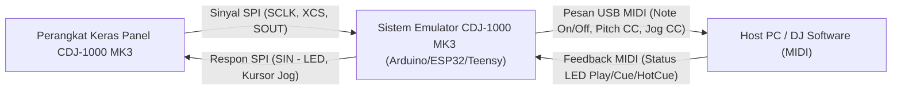
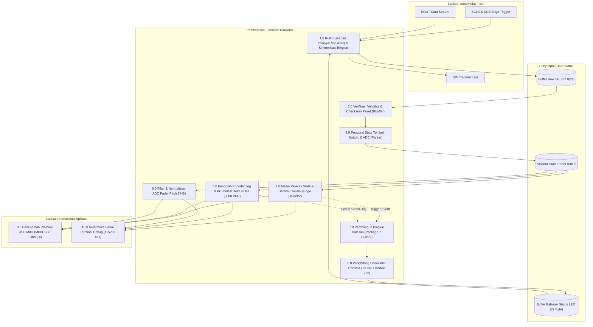

# cdj1000mk3-spi-bridge

**Repositori Resmi:** [https://github.com/rayocta303/cdj1000mk3-spi-bridge](https://github.com/rayocta303/cdj1000mk3-spi-bridge)  
**Pengembang / Author:** Hanif Bagus Saputra  
**Lisensi:** MIT License  
**Bahasa:** [Bahasa Indonesia](README-ID.md) | [English](README.md)  

Dokumentasi teknis, spesifikasi protokol SPI, skematik antarmuka perangkat keras (5V dan 3.3V ESP32 / Teensy), diagram aliran data (DFD), dan panduan implementasi firmware untuk membaca kontrol panel fisik Pioneer CDJ-1000 MK3 serta mengontrol status LED dan display jog menggunakan mikrokontroler.

---

## Daftar Isi
1. [Ringkasan Teknis](#ringkasan-teknis)
2. [Arsitektur Perangkat Lunak](#arsitektur-perangkat-lunak)
3. [Skematik Perangkat Keras dan Diagram Koneksi](#skematik-perangkat-keras-dan-diagram-koneksi)
   - [Skematik 1: Antarmuka Langsung 5V (Arduino Uno, Nano, Mega, Pro Micro 5V)](#skematik-1-antarmuka-langsung-5v-arduino-uno-nano-mega-pro-micro-5v)
   - [Skematik 2: Antarmuka 3.3V dengan IC 74HC245 (ESP32 & Teensy 4.x/3.x)](#skematik-2-antarmuka-33v-dengan-ic-74hc245-esp32--teensy-4x3x)
   - [Skematik 3: Antarmuka 3.3V dengan Modul Level Shifter 4-Channel Siap Pakai](#skematik-3-antarmuka-33v-dengan-modul-level-shifter-4-channel-siap-pakai)
4. [Diagram Aliran Data (Data Flow Diagram - DFD)](#diagram-aliran-data-data-flow-diagram---dfd)
   - [DFD Tingkat 0 (Diagram Konteks)](#dfd-tingkat-0-diagram-konteks)
   - [DFD Tingkat 1 (Dekomposisi Fungsional)](#dfd-tingkat-1-dekomposisi-fungsional)
5. [Konfigurasi Pinout Terpisah](#konfigurasi-pinout-terpisah)
6. [Spesifikasi Protokol Komunikasi SPI](#spesifikasi-protokol-komunikasi-spi)
7. [Struktur Paket Data 27-Byte](#struktur-paket-data-27-byte)
   - [Paket Input: Display Board ke Main Assy (Rbuffer)](#paket-input-display-board-ke-main-assy-rbuffer)
   - [Paket Output: Main Assy ke Display Board (Tbuffer)](#paket-output-main-assy-ke-display-board-tbuffer)
   - [Algoritma Checksum (CRC)](#algoritma-checksum-crc)
8. [Referensi API Kelas Utama](#referensi-api-kelas-utama)
9. [Panduan Penggunaan dan Contoh Aplikasi](#panduan-penggunaan-dan-contoh-aplikasi)
   - [Contoh 1: Serial Monitor Diagnostic](#contoh-1-serial-monitor-diagnostic)
   - [Contoh 2: USB MIDI Controller untuk DJ Software](#contoh-2-usb-midi-controller-untuk-dj-software)
   - [Contoh 3: Main Board Hardware-in-the-Loop Emulator](#contoh-3-main-board-hardware-in-the-loop-emulator)
10. [Lisensi dan Kredit Riset](#lisensi-dan-kredit-riset)

---

## Ringkasan Teknis

Unit Pioneer CDJ-1000 MK3 menggunakan arsitektur modular terdistribusi di mana sub-sistem kontrol panel atas (Display/FL Board - DFLB) dikendalikan oleh mikroprosesor internal khusus. Komunikasi antara Main Board (Main Assy) dan Display Board berjalan melalui bus Serial Peripheral Interface (SPI) berpemilik (*proprietary*) full-duplex dengan panjang bingkai 27 byte.

Library ini mengimplementasikan emulasi dua arah (*bidirectional emulation*):
* **Mode Slave (Default):** Mikrokontroler Arduino/ESP32/Teensy terhubung langsung ke Display Board fisik untuk membaca status seluruh tombol, jog wheel encoder (3600 Pulse per Revolution), sensor sentuh kapasitif/mekanis, dan fader pitch 14-bit. Mikrokontroler sekaligus mengirimkan bingkai balasan untuk menyalakan LED (Play, Cue, Hot Cue tri-color, Loop, Vinyl/CDJ) dan kursor kincir jog display (135 segmen).
* **Mode Master:** Mikrokontroler bertindak sebagai pengganti Display Board untuk mengemulasikan input tombol ke Main Assy motherboard CDJ-1000 MK3.

---

## Arsitektur Perangkat Lunak

Struktur kode dirancang dengan pemisahan lapisan abstraksi (*layer separation*) yang ketat:

```text
P:\CDJ1000MK3-EMULATOR\
├── src\
│   ├── CDJ1000MK3.h             # Master header include
│   ├── CDJ1000MK3_Pins.h        # Konfigurasi pinout terpisah & preset board
│   ├── CDJ1000MK3_Protocol.h    # Definisi konstanta, bitmask tombol/LED, dan struct 27-byte
│   ├── CDJ1000MK3_Protocol.cpp  # Parser paket, pembuat template, dan verifikasi checksum
│   ├── CDJ1000MK3_SPI.h         # Abstraksi driver SPI hardware (Slave & Master)
│   ├── CDJ1000MK3_SPI.cpp       # Rutin layanan interupsi (ISR) SPI & sinkronisasi XCS
│   ├── CDJ1000MK3_Panel.h       # Antarmuka tingkat tinggi CDJ1000MK3_Panel berorientasi objek
│   ├── CDJ1000MK3_Panel.cpp     # Pengolahan state tombol, debounce, kalkulasi delta, & LED
│   └── CDJ1000MK3_MidiMap.h     # Pemetaan standar MIDI Note & Continuous Controller (CC)
├── examples\
│   ├── CDJ1000MK3_Serial_Monitor\
│   │   └── CDJ1000MK3_Serial_Monitor.ino      # Pengujian tombol & LED via Serial Terminal
│   ├── CDJ1000MK3_USB_MIDI\
│   │   ├── CDJ1000MK3_USB_MIDI.ino            # Native USB MIDI controller untuk DJ software
│   │   └── CDJ1000MK3_MIDI_Mapping.csv        # File konfigurasi mapping CSV MIDI standar
│   └── CDJ1000MK3_MainBoard_Emulator\
│       └── CDJ1000MK3_MainBoard_Emulator.ino  # Emulasi panel ke Motherboard CDJ
├── reference\                   # Dokumen riset reverse engineering asli & source C
├── library.properties           # Format manifest standar Arduino Library Manager
├── keywords.txt                 # Definisi syntax highlighting Arduino IDE
└── README.md                    # Dokumentasi teknis proyek
```

---

## Skematik Perangkat Keras dan Diagram Koneksi

### Skematik 1: Antarmuka Langsung 5V (Arduino Uno, Nano, Mega, Pro Micro 5V)

Karena logika Display Board CDJ-1000 MK3 dan mikrokontroler berbasis ATmega328P / ATmega32U4 / ATmega2560 sama-sama bekerja pada **5V**, sirkuit tidak membutuhkan IC level shifter. Cukup 5 kabel langsung:

```text
  PIONEER CDJ-1000 MK3                        ARDUINO MIKROKONTROLER (5V)
  Konektor Panel Atas (CN2002)                (Uno / Nano / Pro Micro / Mega)
 +-----------------------------+             +-------------------------------+
 | Pin 13 : SCLK (SPI Clock)   |------------>| Pin SCK  (D13 / D15 / D52)    |
 | Pin 14 : SOUT (Display Out) |------------>| Pin MOSI (D11 / D16 / D51)    |
 | Pin 15 : SIN  (Display In)  |<------------| Pin MISO (D12 / D14 / D50)    |
 | Pin 16 : XCS  (Chip Select) |------------>| Pin SS   (D10 / D10 / D53)    |
 | Pin GND: Ground             |-------------| Pin GND                       |
 +-----------------------------+             +-------------------------------+
```

---

### Skematik 2: Antarmuka 3.3V dengan IC 74HC245 (ESP32 & Teensy 4.x/3.x)

Display Board CDJ-1000 MK3 mengeluarkan sinyal SPI dengan level tegangan **5V**, sedangkan mikrokontroler ESP32, Teensy 4.0/4.1, dan STM32 bekerja pada level tegangan **3.3V**. Menghubungkan sinyal 5V langsung ke pin 3.3V dapat merusak mikrokontroler secara permanen.

Metode ini menggunakan IC **74HC245 (Octal Bus Transceiver)** yang diberi daya $V_{CC} = 3.3\text{V}$, dilengkapi filter *low-pass* (resistor 10k dan kapasitor keramik 220pF) untuk meredam noise pada kabel pita (*ribbon cable*) panjang CDJ.

#### Daftar Komponen (Bill of Materials per 1 Unit CDJ):
* 1x IC 74HC245 (DIP-20 atau SOIC-20)
* 3x Kapasitor Keramik 220 pF (Filter noise pada jalur SCLK, SOUT, XCS)
* 1x Kapasitor Keramik 1.0 uF (Bypass/decoupling VCC pin 20 ke GND)
* 3x Resistor 10 kOhm (Pull-up ke 3.3V pada sisi input CDJ)
* 1x Resistor 470 Ohm (Resistor proteksi seri pada jalur SIN dari MCU ke CDJ)

*(Catatan: Jika mengendalikan 2 unit CDJ sekaligus untuk Deck 1 & Deck 2, kalikan seluruh jumlah komponen di atas dengan 2).*

#### Diagram Skematik Sirkuit 74HC245:

```text
 Dari CDJ-1000 MK3 (5V)                                               Ke ESP32 / Teensy (3.3V)
 
                          +3.3V (Dari Pin 3V3 MCU)
                            |
                     +------+------+------+
                     |      |      |      |
                    [R1]   [R2]   [R3]   [C4]
                    10K    10K    10K    1uF
                     |      |      |      |
                     |      |      |     GNDD
                     |      |      |
 CDJ Pin 14 (SOUT) --+------+-----------------> Pin 2  (A0)   (B0) Pin 18 --------> ESP32 GPIO 23 / Teensy Pin 11 (MOSI)
                     |             |
                    [C1] 220pF     |
                     |             |
                    GNDD           |
                                   |
 CDJ Pin 16 (XCS)  ---------+------+----------> Pin 3  (A1)   (B1) Pin 17 --------> ESP32 GPIO 5  / Teensy Pin 10 (CS/XCS)
                            |      |
                           [C2] 220pF
                            |      |
                           GNDD    |
                                   |
 CDJ Pin 13 (SCLK) ----------------+----------> Pin 4  (A2)   (B2) Pin 16 --------> ESP32 GPIO 18 / Teensy Pin 13 (SCK)
                            |
                           [C3] 220pF
                            |
                           GNDD
 
                                 74HC245 Pinout:
                                 Pin 1  (DIR / A->B) ---> +3.3V (Arah transmisi A ke B)
                                 Pin 20 (VCC)        ---> +3.3V (Dari Pin 3V3 MCU)
                                 Pin 19 (/OE)        ---> GNDD  (Selalu aktif / Output Enable)
                                 Pin 10 (GND)        ---> GNDD  (Ground bersama)
 
                                 [R4] 470 Ohm
 CDJ Pin 15 (SIN)  <-------------/\/\/\/\------------------------------------------ ESP32 GPIO 19 / Teensy Pin 12 (MISO)
 
 CDJ Pin GND (GNDD) -------------------------------------------------------------- GND (Ground bersama MCU)
```

#### Tabel Rincian Koneksi Pin 74HC245:

| Pin 74HC245 | Nama Pin | Terhubung ke | Level Tegangan | Keterangan Fungsi |
| :---: | :---: | :--- | :---: | :--- |
| **Pin 1** | **DIR (A->B)** | Pin 3.3V MCU | 3.3V | Mengatur arah buffer dari sisi A ke sisi B |
| **Pin 2** | **A0** | CDJ Pin 14 (SOUT) | 5V | Input data serial dari Display Board CDJ |
| **Pin 3** | **A1** | CDJ Pin 16 (XCS) | 5V | Input sinyal seleksi Chip Select dari CDJ |
| **Pin 4** | **A2** | CDJ Pin 13 (SCLK) | 5V | Input sinyal detak Clock SPI dari CDJ |
| **Pin 5-9** | **A3 - A7** | *Tidak terhubung* | - | Saluran cadangan |
| **Pin 10** | **GND** | Ground Bersama (GNDD) | 0V | Ground referensi bersama CDJ dan MCU |
| **Pin 11-15** | **B7 - B3** | *Tidak terhubung* | - | Saluran cadangan |
| **Pin 16** | **B2** | Pin SCK Mikrokontroler | 3.3V | Output Clock SPI aman ke MCU (GPIO 18 / Pin 13) |
| **Pin 17** | **B1** | Pin CS Mikrokontroler | 3.3V | Output Chip Select aman ke MCU (GPIO 5 / Pin 10) |
| **Pin 18** | **B0** | Pin MOSI Mikrokontroler | 3.3V | Output data serial CDJ aman ke input MOSI MCU (GPIO 23 / Pin 11) |
| **Pin 19** | **/OE** | Ground Bersama (GNDD) | 0V | Mengaktifkan output buffer (Active Low) |
| **Pin 20** | **VCC** | Pin 3.3V MCU | 3.3V | Catu daya IC level shifter dari mikrokontroler |

> [!NOTE]
> **Mengapa jalur `SIN` tidak melewati IC 74HC245?**  
> `SIN` adalah jalur data dari mikrokontroler menuju CDJ. Tegangan keluaran 3.3V dari ESP32/Teensy sudah melampaui tegangan ambang batas logika HIGH standar TTL/CMOS CDJ (ambang batas $V_{IH} \approx 2.0\text{V}$). Resistor 470 Ohm dipasang secara seri murni sebagai pembatas arus dan proteksi jika terjadi lonjakan tegangan balik dari CDJ.

---

### Skematik 3: Antarmuka 3.3V dengan Modul Level Shifter 4-Channel Siap Pakai

Jika Anda tidak ingin menyolder IC 74HC245 dan resistor/kapasitor pasif, Anda dapat menggunakan **Modul Bi-directional Logic Level Shifter 4-Channel** berbasis MOSFET (BSS138 atau TXS0108E/TXS0104E) yang banyak dijual di pasaran:

```text
 CDJ-1000 MK3                                MODUL LEVEL SHIFTER                    ESP32 / TEENSY
 (Sisi High Voltage: 5V)                      (4-Channel Bi-directional)             (Sisi Low Voltage: 3.3V)
 +----------------------+                    +--------------------------+           +----------------------+
 | Pin +5V (Internal CDJ)|------------------->| HV  (Tegangan Tinggi 5V) |           |                      |
 | Pin GND (Ground)     |-----+------------->| GND (High Side Ground)   |           |                      |
 |                      |     |              |                          |           |                      |
 |                      |     |              | LV   (Tegangan Rendah)   |<----------| Pin 3V3 (Output 3.3V)|
 |                      |     +------------->| GND (Low Side Ground)    |<----------| Pin GND (Ground)     |
 |                      |                    |                          |           |                      |
 | Pin 13 (SCLK - 5V)   |------------------->| HV1                  LV1 |---------->| Pin SCK (GPIO 18/D13)|
 | Pin 14 (SOUT - 5V)   |------------------->| HV2                  LV2 |---------->| Pin MOSI(GPIO 23/D11)|
 | Pin 16 (XCS  - 5V)   |------------------->| HV3                  LV3 |---------->| Pin CS  (GPIO 5 /D10)|
 | Pin 15 (SIN  - In)   |<-------------------| HV4                  LV4 |<----------| Pin MISO(GPIO 19/D12)|
 +----------------------+                    +--------------------------+           +----------------------+
```

---

## Diagram Aliran Data (Data Flow Diagram - DFD)

### DFD Tingkat 0 (Diagram Konteks)

Diagram konteks menunjukkan interaksi tingkat tinggi antara entitas eksternal (Perangkat Keras CDJ, Operator DJ, dan Host DJ Software) dengan Sistem Emulator CDJ-1000 MK3.



### DFD Tingkat 1 (Dekomposisi Fungsional)

Diagram aliran data tingkat 1 mendekomposisi sistem menjadi proses-proses terisolasi: penanganan sinyal interupsi fisik, parsing bingkai data, manajemen state tombol, pemrosesan jog wheel & pitch, serta subsistem komunikasi MIDI/Serial.



---

## Konfigurasi Pinout Terpisah

Seluruh penetapan pin mikrokontroler dipisahkan dari logika program utama dan berada di file header khusus: [src/CDJ1000MK3_Pins.h](file:///P:/CDJ1000MK3-EMULATOR/src/CDJ1000MK3_Pins.h).

### Tabel Pemetaan Pinout per Tipe Board

| Target Board | Pin SCLK (CDJ Pin 13) | Pin MISO/SOUT (CDJ Pin 14) | Pin MOSI/SIN (CDJ Pin 15) | Pin CS/XCS (CDJ Pin 16) | Level Tegangan |
| :--- | :---: | :---: | :---: | :---: | :---: |
| **Arduino Uno / Nano** | Pin 13 | Pin 12 | Pin 11 | Pin 10 | 5V Langsung |
| **Arduino Pro Micro / Leonardo** | Pin 15 (SCK) | Pin 14 (MISO) | Pin 16 (MOSI) | Pin 10 (SS) | 5V Langsung |
| **Arduino Mega 2560** | Pin 52 | Pin 50 | Pin 51 | Pin 53 | 5V Langsung |
| **ESP32 (Standard VSPI)** | GPIO 18 | GPIO 19 | GPIO 23 | GPIO 5 | 3.3V (Wajib Shifter) |
| **Teensy 3.2 / 4.0 / 4.1** | Pin 13 | Pin 12 | Pin 11 | Pin 10 | 3.3V (Wajib Shifter) |
| **STM32 Blue Pill (SPI1)** | Pin PA5 | Pin PA6 | Pin PA7 | Pin PA4 | 3.3V (Wajib Shifter) |
| **Raspberry Pi Pico (RP2040)** | GP18 | GP16 | GP19 | GP17 | 3.3V (Wajib Shifter) |
| **Kustom (User Defined)** | Kustom | Kustom | Kustom | Kustom | Sesuai Konfigurasi |

### Cara Mengaktifkan Preset atau Pin Kustom
Buka file `src/CDJ1000MK3_Pins.h`. Jika Anda tidak mendefinisikan apa pun, sistem akan melakukan **auto-detection** berdasarkan arsitektur toolchain Arduino IDE.

Untuk menentukan pin kustom secara manual:
```cpp
#define CDJ_BOARD_CUSTOM
#define CDJ_PIN_SCLK    13
#define CDJ_PIN_MISO    12
#define CDJ_PIN_MOSI    11
#define CDJ_PIN_CS      10
#include "CDJ1000MK3.h"
```

---

## Spesifikasi Protokol Komunikasi SPI

* **Mode SPI:** Mode 3.
  * Clock Polarity (`CPOL`): 1 (Clock idle dalam kondisi logis HIGH).
  * Clock Phase (`CPHA`): 1 (Data di-capture pada tepi kedua / trailing edge saat sinyal naik).
* **Urutan Bit (Bit Order):** Most Significant Bit First (`MSBFIRST`).
* **Kecepatan Sinyal Clock:** 1.0 MHz nominal (mendukung rentang 500 kHz hingga 2.0 MHz).
* **Ukuran Transaksi Bingkai:** Tepat 27 Byte secara full-duplex per pertukaran.
* **Peran SPI (Master vs Slave):**
  * Pada unit CDJ-1000 MK3, microcontroller pada Display Board bertindak sebagai **SPI Master** yang membangkitkan clock dan sinyal seleksi `XCS`.
  * Arduino/ESP32/Teensy yang disambungkan ke Display Board **wajib beroperasi sebagai SPI Slave**.
* **Mekanisme Sinkronisasi Bingkai (Frame Sync):**
  * Sinyal `XCS` mengalami transisi LOW saat transmisi 27-byte dimulai.
  * Sinyal `XCS` mengalami transisi HIGH saat transmisi 27-byte berakhir.
  * Driver menggunakan interupsi falling edge `XCS` untuk mereset indeks transmisi (`byteIndex = 0`), mencegah desinkronisasi bit/byte.

---

## Struktur Paket Data 27-Byte

### Paket Input: Display Board ke Main Assy (`Rbuffer`)

Panjang paket: 27 byte. Dikirim dari Display Board menuju Main Assy / Arduino.

| Indeks Byte | Nama Bidang | Tipe / Resolusi | Keterangan Nilai |
| :---: | :--- | :---: | :--- |
| `0` | Header 0 | `uint8_t` | Selalu bernilai konstan `0x01`. |
| `1` | Header 1 | `uint8_t` | Selalu bernilai konstan `0x10`. |
| `2` | ADC Touch/Brake | `uint8_t` | Nilai potensiometer Touch/Brake knob (`0..255`). |
| `3` | ADC Release/Start | `uint8_t` | Nilai potensiometer Release/Start knob (`0..255`). |
| `4` | ADC Pitch MSB | `uint8_t` | 8-bit MSB dari Fader Pitch (Resolusi total 14-bit: `0..16383`). |
| `5` | ADC Pitch LSB | `uint8_t` | 6-bit atas berisi LSB dari Fader Pitch (`AAAAAA00`). |
| `6` | ADC Center Pot MSB | `uint8_t` | 8-bit MSB dari potensiometer tengah pitch. |
| `7` | ADC Center Pot LSB | `uint8_t` | 6-bit atas berisi LSB dari potensiometer tengah pitch. |
| `8` | Jog Pulses MSB | `uint8_t` | MSB pencacah pulsa rotasi kumulatif (`0..65535`). 3600 pulsa per putaran penuh. |
| `9` | Jog Pulses LSB | `uint8_t` | LSB pencacah pulsa rotasi kumulatif. |
| `10` | Jog Speed MSB | `uint8_t` | MSB kecepatan rotasi kincir jog (`65535` saat platter berhenti). |
| `11` | Jog Speed LSB | `uint8_t` | LSB kecepatan rotasi kincir jog. |
| `12` | Jog & Switch Status | `uint8_t` | Bit 0: Eject Lock (`1`=Unlock, `0`=Lock)<br>Bit 1: Direction (`1`=Fwd, `0`=Rev)<br>Bit 4-5: Jog Touch Sensor (`1`=Tangan menyentuh platter)<br>Bit 6: Arah rotasi (`1`=Maju/CW, `0`=Mundur/CCW)<br>Bit 7: Deteksi kincir berputar (`1`=Berputar). |
| `13` | Cadangan | `uint8_t` | Nilai `0x00`. |
| `14` | Tombol Transport | `uint8_t` | Bit 0: PLAY<br>Bit 1: CUE<br>Bit 2: LOOP IN<br>Bit 3: LOOP OUT<br>Bit 4: RELOOP/EXIT<br>Bit 5: HOT CUE A<br>Bit 6: HOT CUE B<br>Bit 7: HOT CUE C. |
| `15` | Cadangan | `uint8_t` | Nilai `0x00`. |
| `16` | Tombol Pencarian | `uint8_t` | Bit 0: REC MODE<br>Bit 1: Track Search Reverse `<<`<br>Bit 2: Track Search Forward `>>`<br>Bit 3: Fast Search Reverse `<<`<br>Bit 4: Fast Search Forward `>>`. |
| `17` | Tombol Mode/Tempo | `uint8_t` | Bit 0: MP3 Folder `<`<br>Bit 1: MP3 Folder `>`<br>Bit 2: JOG MODE (Vinyl/CDJ)<br>Bit 3: TEMPO (Rentang Pitch)<br>Bit 4: MASTER TEMPO<br>Bit 5: TEMPO RESET. |
| `18` | Tombol Memori/Sistem| `uint8_t` | Bit 0: CALL `>`<br>Bit 1: `<` CALL<br>Bit 2: MEMORY<br>Bit 3: DELETE<br>Bit 4: EJECT<br>Bit 5: TIME MODE / AUTO CUE<br>Bit 6: TEXT MODE. |
| `19` | Checksum Paket | `uint8_t` | Checksum verifikasi penerimaan. |
| `20-26` | Status Ekor | `uint8_t[7]` | Pola data konstan: `0xF1, 0x64, 0x76, 0x00, 0x00, 0x00, 0x00`. |

---

### Paket Output: Main Assy ke Display Board (`Tbuffer`)

Main Assy mengirim siklus 8 paket (Paket 0 hingga 7). Paket 7 (`ID = 168 / 0xA8`) berisi status kontrol lampu LED dan indikator jog.

| Indeks Byte | Deskripsi Bidang Paket 7 | Keterangan Nilai / Fungsi Bitmask |
| :---: | :--- | :--- |
| `0` | Identitas Paket | Nilai `168` (`0xA8`) menandakan Paket 7 (Status & LED). |
| `1` | Tempo Digit 1 | Kode 7-segmen digit MSB persentase tempo. |
| `2` | Tempo Digit 2 | Kode 7-segmen digit tengah persentase tempo. |
| `3` | Tempo Digit 3 | Kode 7-segmen digit LSB persentase tempo. |
| `4-5` | Indikator Frame Waktu | Kode 7-segmen frame waktu menit dan detik. |
| `6-8` | Indikator BPM | Kode 7-segmen digit BPM lagu (MSB, Mid, LSB). |
| `9` | Tanda Plus/Minus Tempo | Tanda `+` (`x11xxxxx`), `-` (`x10xxxxx`), atau spasi. |
| `11` | Rentang Tempo VFD | `10010000` (+-6%), `10100000` (+-10%), `11000000` (+-16%), `10000000` (WIDE). |
| `17` | LED Kontrol 1 | Bit 0: PLAY LED (Hijau)<br>Bit 1: CUE LED (Amber)<br>Bit 2: LOOP IN LED<br>Bit 3: LOOP OUT LED<br>Bit 4: RELOOP/EXIT LED<br>Bit 5: REVERSE LED (Merah)<br>Bit 6: HOT CUE A Merah<br>Bit 7: HOT CUE A Hijau. |
| `18` | LED Kontrol 2 | Bit 0: HOT CUE A Oranye<br>Bit 1: HOT CUE B Merah<br>Bit 2: HOT CUE B Hijau<br>Bit 3: HOT CUE B Oranye<br>Bit 4: HOT CUE C Merah<br>Bit 5: HOT CUE C Hijau<br>Bit 6: HOT CUE C Oranye. |
| `19` | LED Kontrol 3 | Bit 3: MASTER TEMPO LED (Merah)<br>Bit 4: TEMPO RESET LED (Hijau)<br>Bit 5: VINYL LED (Biru)<br>Bit 6: CDJ LED (Hijau)<br>Bit 7: SD CARD LED (Hijau). |
| `21` | Kursor Cue Jog Display | Nilai posisi kursor Cue pada ring jog: `1..85` (`0` = Tanpa titik cue). |
| `23` | Indikator Tabung VFD | Bit 3 & 4: Ikon Vinyl aktif<br>Bit 5: Lingkaran VFD sentuh aktif (*touch enable ring*). |
| `25` | **Kursor Posisi Jog Ring** | **Nilai posisi ring melingkar: `1..135`**<br>`136` = Lingkaran penuh<br>`137` = Animasi disk load<br>`138` = Animasi disk eject. |
| `26` | Checksum Paket Transmit | Checksum verifikasi pengiriman. |

---

### Algoritma Checksum (CRC)

Kedua arah paket data menggunakan algoritma penjumlahan aritmatika modulo 256.

#### 1. Checksum Pengiriman (Tx Checksum pada `Tbuffer[26]`)
Menjumlahkan data dari byte indeks 1 sampai dengan byte indeks 25:
$$\text{CRC}_{\text{TX}} = \left( \sum_{i=1}^{25} \text{Tbuffer}[i] \right) \pmod{256}$$

#### 2. Checksum Penerimaan (Rx Checksum pada `Rbuffer[19]`)
Menjumlahkan data dari byte indeks 1 sampai dengan byte indeks 18:
$$\text{CRC}_{\text{RX}} = \left( \sum_{i=1}^{18} \text{Rbuffer}[i] \right) \pmod{256}$$

---

## Referensi API Kelas Utama

### Kelas `CDJ1000MK3_Panel`
Objek utama pengendali status panel atas CDJ-1000 MK3.

```cpp
#include "CDJ1000MK3.h"
CDJ1000MK3_Panel cdj;
```

#### Metode Inisialisasi & Siklus Utama
* `bool begin(CDJ_SpiRole_t role = CDJ_ROLE_SLAVE, uint8_t csPin = CDJ_PIN_CS, uint32_t clockSpeed = CDJ_SPI_CLOCK_HZ)`:  
  Menginisialisasi antarmuka SPI hardware sesuai peran (`CDJ_ROLE_SLAVE` atau `CDJ_ROLE_MASTER`), pin Chip Select, dan kecepatan clock SPI yang dipilih.
* `bool setRole(CDJ_SpiRole_t role, uint32_t clockSpeed = CDJ_SPI_CLOCK_HZ)`:  
  Mengganti peran operasional SPI (Master <-> Slave) secara dinamis saat runtime tanpa me-reset mikrokontroler. Fungsi ini otomatis mengonfigurasi ulang register kontrol SPI AVR/ESP32, mengaktifkan/menonaktifkan interupsi, dan mengubah arah pin (*pin direction*).
* `CDJ_SpiRole_t getRole() const`:  
  Mengembalikan peran SPI yang sedang aktif (`CDJ_ROLE_MASTER` atau `CDJ_ROLE_SLAVE`).
* `bool isMaster() const`: Mengembalikan `true` jika mikrokontroler sedang beroperasi dalam mode SPI Master.
* `bool isSlave() const`: Mengembalikan `true` jika mikrokontroler sedang beroperasi dalam mode SPI Slave.
* `void setMasterPollInterval(uint32_t intervalMs)`:  
  Mengatur interval siklus transmisi SPI Master dalam milidetik (default: `15` ms atau ~66 Hz).
* `uint32_t getMasterPollInterval() const`:  
  Mengembalikan nilai interval polling Master mode yang sedang aktif.
* `bool update()`:  
  Memproses komunikasi SPI (baik polling Master maupun event interrupt Slave), mem-parse status tombol, mendeteksi transisi perubahan (*edge changes*), dan memperbarui data balasan LED. Wajib dipanggil berulang di dalam fungsi `loop()`.

#### Metode Registrasi Callback
* `void onButton(void (*cb)(CDJ_ButtonId_t btn, bool pressed))`:  
  Mendaftarkan fungsi callback saat terjadi perubahan penekanan tombol.
* `void onJog(void (*cb)(int16_t delta, bool touched, uint16_t speed))`:  
  Mendaftarkan fungsi callback saat platter jog berputar atau disentuh.
* `void onPitch(void (*cb)(uint16_t pitchValue))`:  
  Mendaftarkan fungsi callback saat posisi fader pitch bergeser.

#### Metode Pembacaan Input Status
* `bool isPressed(CDJ_ButtonId_t btn) const`: Mengembalikan `true` jika tombol sedang ditahan.
* `bool justPressed(CDJ_ButtonId_t btn) const`: Mengembalikan `true` tepat pada siklus saat tombol mulai ditekan.
* `bool justReleased(CDJ_ButtonId_t btn) const`: Mengembalikan `true` tepat pada siklus saat tombol dilepaskan.
* `bool isJogTouched() const`: Status sentuhan tangan pada permukaan metalik jog platter.
* `int16_t getJogDelta() const`: Selisih jumlah pulsa encoder sejak pembacaan frame sebelumnya.
* `uint16_t getJogPulses() const`: Nilai register pencacah pulsa kincir jog (`0..65535`).
* `uint16_t getPitch() const`: Nilai ADC fader pitch resolusi 14-bit (`0..16383`, nilai tengah ~`8192`).
* `uint8_t getTouchBrake() const`: Posisi knob Touch/Brake (`0..255`).
* `uint8_t getReleaseStart() const`: Posisi knob Release/Start (`0..255`).

#### Metode Kontrol Output LED & Display
* `void setPlayLed(bool on)`: Mengatur status LED tombol Play (Hijau).
* `void setCueLed(bool on)`: Mengatur status LED tombol Cue (Amber).
* `void setLoopInLed(bool on)`: Mengatur status LED Loop In.
* `void setLoopOutLed(bool on)`: Mengatur status LED Loop Out.
* `void setHotCue(uint8_t cueIndex, CDJ_HotCueColor_t color)`: Mengatur warna Hot Cue A (`0`), B (`1`), atau C (`2`). Pilihan warna: `HOTCUE_OFF`, `HOTCUE_GREEN`, `HOTCUE_ORANGE`, `HOTCUE_RED`.
* `void setVinylLed(bool on)`: Mengatur LED indikator mode Vinyl (Biru).
* `void setCdjLed(bool on)`: Mengatur LED indikator mode CDJ (Hijau).
* `void setJogPosition(uint8_t pos)`: Mengatur posisi LED kursor melingkar jog display (`1..135`).
* `void setJogCuePosition(uint8_t cuePos)`: Mengatur posisi penanda cue pada jog display (`0..85`).
* `void setTouchRing(bool on)`: Menyalakan atau mematikan visual lingkaran sentuh pada VFD tengah.
* `void commitLeds()`: Menuliskan perubahan LED langsung ke frame transmisi SPI.

---

## Panduan Penggunaan dan Contoh Aplikasi

### Contoh 1: Serial Monitor Diagnostic

Contoh ini membaca seluruh interaksi hardware fisik dan mencetak datanya ke Serial Monitor (baud rate 115200), serta menyediakan perintah terminal untuk menguji seluruh lampu LED panel.

* **Path File:** [examples/CDJ1000MK3_Serial_Monitor/CDJ1000MK3_Serial_Monitor.ino](file:///P:/CDJ1000MK3-EMULATOR/examples/CDJ1000MK3_Serial_Monitor/CDJ1000MK3_Serial_Monitor.ino)
* **Board yang Didukung:** Arduino Uno, Nano, Mega 2560, Pro Micro, ESP32, Teensy, STM32.

```cpp
#include <Arduino.h>
#include "CDJ1000MK3.h"

CDJ1000MK3_Panel cdj;

void setup() {
    Serial.begin(115200);
    cdj.begin(CDJ_ROLE_SLAVE); // Menggunakan pin dari CDJ1000MK3_Pins.h

    cdj.onButton([](CDJ_ButtonId_t btn, bool pressed) {
        Serial.print("Tombol: ");
        Serial.print(CDJ1000MK3_Panel::getButtonName(btn));
        Serial.println(pressed ? " -> PRESSED" : " -> RELEASED");
    });

    cdj.onJog([](int16_t delta, bool touched, uint16_t speed) {
        Serial.print("Jog Delta: ");
        Serial.print(delta);
        Serial.print(" | Sentuh: ");
        Serial.println(touched ? "YA" : "TIDAK");
    });
}

void loop() {
    cdj.update();
}
```

---

### Contoh 2: USB MIDI Controller untuk DJ Software

Mengubah panel CDJ-1000 MK3 menjadi konsol DJ MIDI dengan antarmuka native USB untuk mengendalikan software DJ profesional (Traktor, VirtualDJ, Mixxx) secara real-time.

* **Path Sketch:** [examples/CDJ1000MK3_USB_MIDI/CDJ1000MK3_USB_MIDI.ino](file:///P:/CDJ1000MK3-EMULATOR/examples/CDJ1000MK3_USB_MIDI/CDJ1000MK3_USB_MIDI.ino)
* **File Mapping:** [examples/CDJ1000MK3_USB_MIDI/CDJ1000MK3_MIDI_Mapping.csv](file:///P:/CDJ1000MK3-EMULATOR/examples/CDJ1000MK3_USB_MIDI/CDJ1000MK3_MIDI_Mapping.csv)
* **Board yang Direkomendasikan:** Arduino Pro Micro (ATmega32U4), Teensy 4.0/3.2, Raspberry Pi Pico (RP2040).

#### Prosedur Konfigurasi MIDI:
1. Hubungkan board Arduino Pro Micro / Teensy / Pico ke port USB komputer.
2. Buka software DJ Anda (Traktor, VirtualDJ, Mixxx).
3. Buka menu pengaturan / konfigurasi MIDI.
4. Klik tombol **Import** mapping.
5. Pilih file [CDJ1000MK3_MIDI_Mapping.csv](file:///P:/CDJ1000MK3-EMULATOR/examples/CDJ1000MK3_USB_MIDI/CDJ1000MK3_MIDI_Mapping.csv).
6. Software DJ akan langsung mengenali mapping: tombol Play, Cue, Loop, Hot Cue A/B/C, Pitch Slider 14-bit resolusi tinggi, kursor rotasi, serta vinyl scratch saat platter disentuh.

---

### Contoh 3: Main Board Hardware-in-the-Loop Emulator

Mengemulasikan respon panel Display Board ke motherboard CDJ-1000 MK3 (*Main Assy*). Sangat berguna bagi teknisi perbaikan untuk menguji fungsionalitas mainboard, mekanisme transportasi CD drive, dan output audio tanpa perlu memasang panel fisik CDJ.

* **Path Sketch:** [examples/CDJ1000MK3_MainBoard_Emulator/CDJ1000MK3_MainBoard_Emulator.ino](file:///P:/CDJ1000MK3-EMULATOR/examples/CDJ1000MK3_MainBoard_Emulator/CDJ1000MK3_MainBoard_Emulator.ino)
* **Karakteristik Operasional:** Mengoperasikan Arduino pada mode SPI Master dengan clock 1 MHz dan mengirimkan sinyal periodik 50 Hz ke konektor CN2002 motherboard untuk mencegah terjadinya kode kesalahan *E-8709* (*Communication Error*).

---

## Lisensi dan Kredit Riset

Proyek ini dilisensikan di bawah **MIT License**. Teks lisensi lengkap dapat dibaca pada file [LICENSE](file:///P:/CDJ1000MK3-EMULATOR/LICENSE).

* **Hak Cipta:** (c) 2026 Hanif Bagus Saputra
* **Repositori GitHub:** [https://github.com/rayocta303/cdj1000mk3-spi-bridge](https://github.com/rayocta303/cdj1000mk3-spi-bridge)

### Kredit Riset & Dasar Protokol:
Proyek ini mengintegrasikan dan menyempurnakan dokumentasi serta riset reverse-engineering yang dirintis oleh:
1. **Andrei Anatsko** (*Reverse Engineering Pioneer CDJ-1000 serial protocol*).
2. **vandoeselaar** (*CDJ-1000 mk3 MIDI bridge project*).
