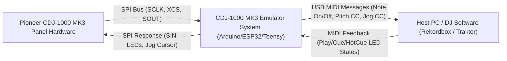
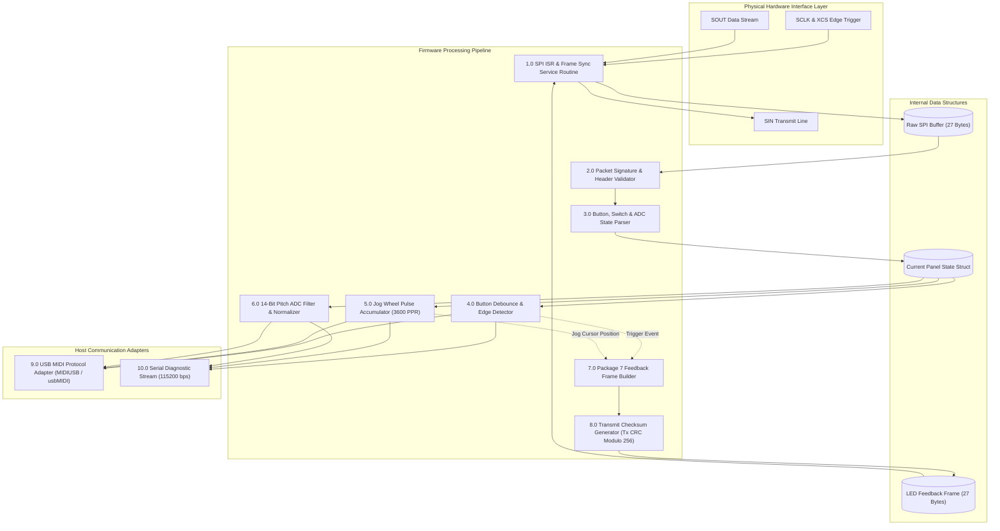

# cdj1000mk3-spi-bridge

**Official Repository:** [https://github.com/rayocta303/cdj1000mk3-spi-bridge](https://github.com/rayocta303/cdj1000mk3-spi-bridge)  
**Developer / Author:** Hanif Bagus Saputra  
**License:** MIT License  
**Languages:** [English](README.md) | [Bahasa Indonesia](README-ID.md)

Technical documentation, SPI protocol specifications, hardware interface schematics (5V and 3.3V ESP32 / Teensy), Data Flow Diagrams (DFD), and firmware implementation guide for reading the physical Pioneer CDJ-1000 MK3 panel controls, status LEDs, and jog wheel display using microcontrollers.

---

## Table of Contents
1. [Technical Overview](#technical-overview)
2. [Software Architecture](#software-architecture)
3. [Hardware Schematics and Wiring Diagrams](#hardware-schematics-and-wiring-diagrams)
   - [Schematic 1: Direct 5V Interface (Arduino Uno, Nano, Mega, Pro Micro 5V)](#schematic-1-direct-5v-interface-arduino-uno-nano-mega-pro-micro-5v)
   - [Schematic 2: 3.3V Interface with 74HC245 Transceiver (ESP32 & Teensy 4.x/3.x)](#schematic-2-33v-interface-with-74hc245-transceiver-esp32--teensy-4x3x)
   - [Schematic 3: 3.3V Interface with 4-Channel Level Shifter Module](#schematic-3-33v-interface-with-4-channel-level-shifter-module)
4. [Data Flow Diagrams (DFD)](#data-flow-diagrams-dfd)
   - [Level 0 DFD (Context Diagram)](#level-0-dfd-context-diagram)
   - [Level 1 DFD (Functional Decomposition)](#level-1-dfd-functional-decomposition)
5. [Modular Pinout Configuration](#modular-pinout-configuration)
6. [SPI Communication Protocol Specification](#spi-communication-protocol-specification)
7. [27-Byte Packet Data Structures](#27-byte-packet-data-structures)
   - [Input Packet: Display Board to Main Assy (Rbuffer)](#input-packet-display-board-to-main-assy-rbuffer)
   - [Output Packet: Main Assy to Display Board (Tbuffer)](#output-packet-main-assy-to-display-board-tbuffer)
   - [Checksum Algorithm (CRC)](#checksum-algorithm-crc)
8. [Core Class API Reference](#core-class-api-reference)
9. [Usage Guide and Application Examples](#usage-guide-and-application-examples)
   - [Example 1: Serial Monitor Diagnostic](#example-1-serial-monitor-diagnostic)
   - [Example 2: USB MIDI Controller for Rekordbox](#example-2-usb-midi-controller-for-rekordbox)
   - [Example 3: Main Board Hardware-in-the-Loop Emulator](#example-3-main-board-hardware-in-the-loop-emulator)
10. [License and Research Credits](#license-and-research-credits)

---

## Technical Overview

The Pioneer CDJ-1000 MK3 utilizes a distributed modular architecture where the top panel control sub-system (Display/FL Board - DFLB) is governed by its own dedicated on-board microprocessor. Communication between the Main Board (Main Assy) and the Display Board operates across a proprietary, full-duplex Serial Peripheral Interface (SPI) bus using fixed 27-byte transactions.

This library provides full bidirectional emulation:
* **Slave Mode (Default):** An Arduino, ESP32, or Teensy microcontroller connects directly to the physical Display Board to read all button states, optical jog wheel encoder pulses (3600 Pulses per Revolution), capacitive/mechanical touch sensors, and 14-bit pitch fader values. Simultaneously, the MCU transmits feedback frames to drive transport and status LEDs (Play, Cue, Tri-color Hot Cues, Loop, Vinyl/CDJ) and update the 135-segment circular jog display cursor.
* **Master Mode:** The microcontroller emulates the Display Board to send button and sensor events directly to the CDJ-1000 MK3 Main Assy motherboard.

---

## Software Architecture

The codebase enforces strict separation of concerns across abstraction layers:

```text
P:\CDJ1000MK3-EMULATOR\
├── src\
│   ├── CDJ1000MK3.h             # Master include header
│   ├── CDJ1000MK3_Pins.h        # Dedicated pinout configuration & board presets
│   ├── CDJ1000MK3_Protocol.h    # Protocol definitions, button/LED bitmasks, 27-byte structs
│   ├── CDJ1000MK3_Protocol.cpp  # Packet parser, frame builder, and signature verification
│   ├── CDJ1000MK3_SPI.h         # Hardware SPI driver abstraction (Slave & Master)
│   ├── CDJ1000MK3_SPI.cpp       # SPI interrupt service routines (ISR) & XCS frame sync
│   ├── CDJ1000MK3_Panel.h       # High-level object-oriented CDJ1000MK3_Panel interface
│   ├── CDJ1000MK3_Panel.cpp     # Button debouncing, delta calculation, and LED control
│   └── CDJ1000MK3_MidiMap.h     # Standard MIDI Note & Continuous Controller (CC) mappings
├── examples\
│   ├── CDJ1000MK3_Serial_Monitor\
│   │   └── CDJ1000MK3_Serial_Monitor.ino      # Hardware diagnostic via Serial Terminal
│   ├── CDJ1000MK3_USB_MIDI\
│   │   ├── CDJ1000MK3_USB_MIDI.ino            # Native USB MIDI controller for Rekordbox
│   │   └── CDJ1000MK3_Rekordbox.csv           # Rekordbox CSV MIDI mapping configuration
│   └── CDJ1000MK3_MainBoard_Emulator\
│       └── CDJ1000MK3_MainBoard_Emulator.ino  # Top panel emulator for CDJ Motherboard
├── reference\                   # Original reverse engineering research notes & C sources
├── library.properties           # Arduino Library Manager specification manifest
├── keywords.txt                 # Arduino IDE syntax highlighting keywords
├── README.md                    # English technical documentation
└── README-ID.md                 # Indonesian technical documentation
```

---

## Hardware Schematics and Wiring Diagrams

### Schematic 1: Direct 5V Interface (Arduino Uno, Nano, Mega, Pro Micro 5V)

Because both the CDJ-1000 MK3 Display Board and 5V ATmega-based microcontrollers (ATmega328P, ATmega32U4, ATmega2560) operate on **5V TTL logic**, no level shifter is required. A direct 5-wire connection is sufficient:

```text
  PIONEER CDJ-1000 MK3                        ARDUINO MICROCONTROLLER (5V)
  Top Panel Connector (CN2002)                (Uno / Nano / Pro Micro / Mega)
 +-----------------------------+             +-------------------------------+
 | Pin 13 : SCLK (SPI Clock)   |------------>| Pin SCK  (D13 / D15 / D52)    |
 | Pin 14 : SOUT (Display Out) |------------>| Pin MOSI (D11 / D16 / D51)    |
 | Pin 15 : SIN  (Display In)  |<------------| Pin MISO (D12 / D14 / D50)    |
 | Pin 16 : XCS  (Chip Select) |------------>| Pin SS   (D10 / D10 / D53)    |
 | Pin GND: Ground             |-------------| Pin GND                       |
 +-----------------------------+             +-------------------------------+
```

---

### Schematic 2: 3.3V Interface with 74HC245 Transceiver (ESP32 & Teensy 4.x/3.x)

The CDJ-1000 MK3 Display Board outputs SPI signals at **5V**, while modern microcontrollers such as the ESP32, Teensy 4.0/4.1, and STM32 operate strictly at **3.3V**. Connecting 5V signals directly to 3.3V GPIO pins will cause permanent damage.

This design utilizes an octal bus transceiver (**74HC245**) powered from $V_{CC} = 3.3\text{V}$, supplemented with low-pass filtering (10k pull-up resistors and 220pF ceramic capacitors) to suppress transient ringing across long CDJ ribbon cables.

#### Bill of Materials (per 1 CDJ Unit):
* 1x 74HC245 IC (DIP-20 or SOIC-20)
* 3x Ceramic Capacitors 220 pF (Noise filter on SCLK, SOUT, and XCS lines)
* 1x Ceramic Capacitor 1.0 uF (Decoupling bypass from pin 20 VCC to GND)
* 3x Resistors 10 kOhm (Pull-up to 3.3V on input side)
* 1x Resistor 470 Ohm (Series protection on the SIN line from MCU to CDJ)

*(Note: If connecting two CDJ units simultaneously for Deck 1 and Deck 2, double all component quantities).*

#### 74HC245 Circuit Schematic:

```text
 From CDJ-1000 MK3 (5V)                                               To ESP32 / Teensy (3.3V)
 
                          +3.3V (From MCU 3V3 Pin)
                            |
                     +------+------+------+
                     |      |      |      |
                    [R1]   [R2]   [R3]   [C4]
                    10K    10K    10K    1uF
                     |      |      |      |
                     |      |      |     GND
                     |      |      |
 CDJ Pin 14 (SOUT) --+------+-----------------> Pin 2  (A0)   (B0) Pin 18 --------> ESP32 GPIO 23 / Teensy Pin 11 (MOSI)
                     |             |
                    [C1] 220pF     |
                     |             |
                    GND            |
                                   |
 CDJ Pin 16 (XCS)  ---------+------+----------> Pin 3  (A1)   (B1) Pin 17 --------> ESP32 GPIO 5  / Teensy Pin 10 (CS/XCS)
                            |      |
                           [C2] 220pF
                            |      |
                           GND     |
                                   |
 CDJ Pin 13 (SCLK) ----------------+----------> Pin 4  (A2)   (B2) Pin 16 --------> ESP32 GPIO 18 / Teensy Pin 13 (SCK)
                            |
                           [C3] 220pF
                            |
                           GND
 
                                 74HC245 Pinout:
                                 Pin 1  (DIR / A->B) ---> +3.3V (Buffer direction A to B)
                                 Pin 20 (VCC)        ---> +3.3V (From MCU 3V3 rail)
                                 Pin 19 (/OE)        ---> GND   (Always active / Output Enable Low)
                                 Pin 10 (GND)        ---> GND   (Common system ground)
 
                                 [R4] 470 Ohm
 CDJ Pin 15 (SIN)  <-------------/\/\/\/\------------------------------------------ ESP32 GPIO 19 / Teensy Pin 12 (MISO)
 
 CDJ Pin GND (GNDD) -------------------------------------------------------------- GND (Common MCU Ground)
```

#### 74HC245 Pin Connection Table:

| 74HC245 Pin | Pin Name | Connected To | Voltage Level | Description |
| :---: | :---: | :--- | :---: | :--- |
| **Pin 1** | **DIR (A->B)** | MCU 3.3V Rail | 3.3V | Sets buffer propagation direction from side A to side B |
| **Pin 2** | **A0** | CDJ Pin 14 (SOUT) | 5V | Serial data input from CDJ Display Board |
| **Pin 3** | **A1** | CDJ Pin 16 (XCS) | 5V | Chip Select frame sync input from CDJ |
| **Pin 4** | **A2** | CDJ Pin 13 (SCLK) | 5V | SPI Clock signal input from CDJ |
| **Pin 5-9** | **A3 - A7** | *Unconnected* | - | Spare channels |
| **Pin 10** | **GND** | Common Ground (GND) | 0V | Common reference ground for CDJ and MCU |
| **Pin 11-15** | **B7 - B3** | *Unconnected* | - | Spare channels |
| **Pin 16** | **B2** | MCU SCK Pin | 3.3V | Level-shifted safe SPI Clock to MCU (GPIO 18 / Pin 13) |
| **Pin 17** | **B1** | MCU CS Pin | 3.3V | Level-shifted safe Chip Select to MCU (GPIO 5 / Pin 10) |
| **Pin 18** | **B0** | MCU MOSI Pin | 3.3V | Level-shifted safe CDJ serial data to MCU MOSI (GPIO 23 / Pin 11) |
| **Pin 19** | **/OE** | Common Ground (GND) | 0V | Enables buffer outputs (Active Low) |
| **Pin 20** | **VCC** | MCU 3.3V Rail | 3.3V | Power supply rail for the level shifter IC |

> [!NOTE]
> **Why does the `SIN` line bypass the 74HC245 IC?**  
> `SIN` is the data line transmitted from the microcontroller to the CDJ Display Board. The 3.3V output high voltage from an ESP32 or Teensy reliably exceeds the minimum logic HIGH threshold of the CDJ CMOS input buffer ($V_{IH} \approx 2.0\text{V}$). A 470 Ohm series resistor is placed purely as current limiting protection against reverse transients.

---

### Schematic 3: 3.3V Interface with 4-Channel Level Shifter Module

For quick prototyping without discrete components, a standard commercial **4-Channel Bi-directional MOSFET Logic Level Shifter Module** (BSS138, TXS0108E, or TXS0104E) can be used:

```text
 CDJ-1000 MK3                                LEVEL SHIFTER MODULE                   ESP32 / TEENSY
 (High Voltage Side: 5V)                      (4-Channel Bi-directional)             (Low Voltage Side: 3.3V)
 +----------------------+                    +--------------------------+           +----------------------+
 | Pin +5V (Internal CDJ)|------------------->| HV  (High Voltage 5V)    |           |                      |
 | Pin GND (Ground)     |-----+------------->| GND (High Side Ground)   |           |                      |
 |                      |     |              |                          |           |                      |
 |                      |     |              | LV   (Low Voltage 3.3V)  |<----------| Pin 3V3 (3.3V Rail)  |
 |                      |     +------------->| GND (Low Side Ground)    |<----------| Pin GND (Ground)     |
 |                      |                    |                          |           |                      |
 | Pin 13 (SCLK - 5V)   |------------------->| HV1                  LV1 |---------->| Pin SCK (GPIO 18/D13)|
 | Pin 14 (SOUT - 5V)   |------------------->| HV2                  LV2 |---------->| Pin MOSI(GPIO 23/D11)|
 | Pin 16 (XCS  - 5V)   |------------------->| HV3                  LV3 |---------->| Pin CS  (GPIO 5 /D10)|
 | Pin 15 (SIN  - In)   |<-------------------| HV4                  LV4 |<----------| Pin MISO(GPIO 19/D12)|
 +----------------------+                    +--------------------------+           +----------------------+
```

---

## Data Flow Diagrams (DFD)

### Level 0 DFD (Context Diagram)

The context diagram illustrates high-level data exchange between external entities (CDJ Hardware, DJ Operator, and Host DJ Software) and the CDJ-1000 MK3 Emulator System:



### Level 1 DFD (Functional Decomposition)

The Level 1 diagram breaks the firmware into isolated functional blocks: hardware interrupt routines, packet signature validation, button state tracking, jog encoder and pitch fader processing, and host communication adapters:



---

## Modular Pinout Configuration

All microcontroller pin definitions are isolated from the core library logic and maintained in a dedicated configuration file: [src/CDJ1000MK3_Pins.h](file:///P:/CDJ1000MK3-EMULATOR/src/CDJ1000MK3_Pins.h).

### Board Mapping Table

| Target Microcontroller | SCLK Pin (CDJ Pin 13) | MISO/SOUT Pin (CDJ Pin 14) | MOSI/SIN Pin (CDJ Pin 15) | CS/XCS Pin (CDJ Pin 16) | Operating Voltage |
| :--- | :---: | :---: | :---: | :---: | :---: |
| **Arduino Uno / Nano** | Pin 13 | Pin 12 | Pin 11 | Pin 10 | 5V Direct |
| **Arduino Pro Micro / Leonardo** | Pin 15 (SCK) | Pin 14 (MISO) | Pin 16 (MOSI) | Pin 10 (SS) | 5V Direct |
| **Arduino Mega 2560** | Pin 52 | Pin 50 | Pin 51 | Pin 53 | 5V Direct |
| **ESP32 (Standard VSPI)** | GPIO 18 | GPIO 19 | GPIO 23 | GPIO 5 | 3.3V (Shifter Required) |
| **Teensy 3.2 / 4.0 / 4.1** | Pin 13 | Pin 12 | Pin 11 | Pin 10 | 3.3V (Shifter Required) |
| **STM32 Blue Pill (SPI1)** | Pin PA5 | Pin PA6 | Pin PA7 | Pin PA4 | 3.3V (Shifter Required) |
| **Raspberry Pi Pico (RP2040)** | GP18 | GP16 | GP19 | GP17 | 3.3V (Shifter Required) |
| **Custom (User Defined)** | User Defined | User Defined | User Defined | User Defined | Per Configuration |

### Enabling Presets or Custom Pins
By default, the header uses architecture macros to **auto-detect** the board target during compilation.

To specify custom pins manually:
```cpp
#define CDJ_BOARD_CUSTOM
#define CDJ_PIN_SCLK    13
#define CDJ_PIN_MISO    12
#define CDJ_PIN_MOSI    11
#define CDJ_PIN_CS      10
#include "CDJ1000MK3.h"
```

---

## SPI Communication Protocol Specification

* **SPI Mode:** Mode 3.
  * Clock Polarity (`CPOL`): 1 (Clock idles in logic HIGH state).
  * Clock Phase (`CPHA`): 1 (Data is sampled on the trailing/rising edge).
* **Bit Order:** Most Significant Bit First (`MSBFIRST`).
* **Clock Frequency:** 1.0 MHz nominal (operational range: 500 kHz to 2.0 MHz).
* **Frame Size:** Exactly 27 Bytes per full-duplex transaction.
* **SPI Role Assignment (Master vs. Slave):**
  * The microprocessor on the CDJ-1000 MK3 Display Board operates as the **SPI Master**, driving SCLK and asserting `XCS`.
  * Microcontrollers attached to the panel **must operate as an SPI Slave**.
* **Frame Synchronization Protocol:**
  * `XCS` transitions LOW when a 27-byte packet transaction begins.
  * `XCS` transitions HIGH when the 27-byte transaction completes.
  * The driver synchronizes using an `XCS` falling edge interrupt to reset the byte transmission counter (`byteIndex = 0`), preventing bit-level or byte-level framing drift.

---

## 27-Byte Packet Data Structures

### Input Packet: Display Board to Main Assy (`Rbuffer`)

Packet size: 27 bytes. Transmitted from the Display Board to the Main Assy / Arduino.

| Byte Index | Field Name | Type / Resolution | Description |
| :---: | :--- | :---: | :--- |
| `0` | Header 0 | `uint8_t` | Constant synchronization byte `0x01`. |
| `1` | Header 1 | `uint8_t` | Constant synchronization byte `0x10`. |
| `2` | ADC Touch/Brake | `uint8_t` | Potentiometer value for Touch/Brake knob (`0..255`). |
| `3` | ADC Release/Start | `uint8_t` | Potentiometer value for Release/Start knob (`0..255`). |
| `4` | ADC Pitch MSB | `uint8_t` | Upper 8 bits of 14-bit pitch fader (`0..16383`). |
| `5` | ADC Pitch LSB | `uint8_t` | Upper 6 bits contain pitch fader LSB (`AAAAAA00`). |
| `6` | ADC Center Pot MSB | `uint8_t` | Upper 8 bits of pitch center potentiometer. |
| `7` | ADC Center Pot LSB | `uint8_t` | Upper 6 bits contain center potentiometer LSB. |
| `8` | Jog Pulses MSB | `uint8_t` | Cumulative pulse counter MSB (`0..65535`, 3600 PPR). |
| `9` | Jog Pulses LSB | `uint8_t` | Cumulative pulse counter LSB. |
| `10` | Jog Speed MSB | `uint8_t` | Rotation speed MSB (`65535` when stopped). |
| `11` | Jog Speed LSB | `uint8_t` | Rotation speed LSB. |
| `12` | Jog & Switch Status | `uint8_t` | Bit 0: Eject Lock (`1`=Unlock, `0`=Lock)<br>Bit 1: Direction Switch (`1`=Forward, `0`=Reverse)<br>Bit 4-5: Jog Touch Sensor (`1`=Hand on platter)<br>Bit 6: Rotation Direction (`1`=CW, `0`=CCW)<br>Bit 7: Platter Rotation Detected (`1`=Moving). |
| `13` | Reserved | `uint8_t` | Always `0x00`. |
| `14` | Transport Buttons | `uint8_t` | Bit 0: PLAY<br>Bit 1: CUE<br>Bit 2: LOOP IN<br>Bit 3: LOOP OUT<br>Bit 4: RELOOP/EXIT<br>Bit 5: HOT CUE A<br>Bit 6: HOT CUE B<br>Bit 7: HOT CUE C. |
| `15` | Reserved | `uint8_t` | Always `0x00`. |
| `16` | Search Buttons | `uint8_t` | Bit 0: REC MODE<br>Bit 1: Track Search Reverse `<<`<br>Bit 2: Track Search Forward `>>`<br>Bit 3: Fast Search Reverse `<<`<br>Bit 4: Fast Search Forward `>>`. |
| `17` | Navigation & Tempo Buttons | `uint8_t` | Bit 0: MP3 Folder `<`<br>Bit 1: MP3 Folder `>`<br>Bit 2: JOG MODE (Vinyl/CDJ)<br>Bit 3: TEMPO (Pitch Range)<br>Bit 4: MASTER TEMPO<br>Bit 5: TEMPO RESET. |
| `18` | Memory & Utility Buttons | `uint8_t` | Bit 0: CALL `>`<br>Bit 1: `<` CALL<br>Bit 2: MEMORY<br>Bit 3: DELETE<br>Bit 4: EJECT<br>Bit 5: TIME MODE / AUTO CUE<br>Bit 6: TEXT MODE. |
| `19` | Checksum / Status | `uint8_t` | Packet reception verification byte. |
| `20-26` | Fixed Tail Signature | `uint8_t[7]` | Constant tail signature: `0xF1, 0x64, 0x76, 0x00, 0x00, 0x00, 0x00`. |

---

### Output Packet: Main Assy to Display Board (`Tbuffer`)

The Main Assy sends an 8-packet cycle (Packages 0 through 7). Package 7 (`ID = 168 / 0xA8`) carries LED states and jog display feedback:

| Byte Index | Package 7 Field | Bitmask / Value Description |
| :---: | :--- | :--- |
| `0` | Package Identifier | Value `168` (`0xA8`) designates Package 7 (Status & LEDs). |
| `1` | Tempo Digit 1 | 7-segment encoding for tempo percentage MSB digit. |
| `2` | Tempo Digit 2 | 7-segment encoding for tempo percentage middle digit. |
| `3` | Tempo Digit 3 | 7-segment encoding for tempo percentage LSB digit. |
| `4-5` | Time Display Digits | 7-segment encoding for minutes and seconds. |
| `6-8` | BPM Display Digits | 7-segment encoding for track BPM (MSB, Mid, LSB). |
| `9` | Tempo Sign | Sign indicator: `+` (`x11xxxxx`), `-` (`x10xxxxx`), or blank. |
| `11` | VFD Tempo Range | `10010000` (+-6%), `10100000` (+-10%), `11000000` (+-16%), `10000000` (WIDE). |
| `17` | LED Control 1 | Bit 0: PLAY LED (Green)<br>Bit 1: CUE LED (Amber)<br>Bit 2: LOOP IN LED<br>Bit 3: LOOP OUT LED<br>Bit 4: RELOOP/EXIT LED<br>Bit 5: REVERSE LED (Red)<br>Bit 6: HOT CUE A Red<br>Bit 7: HOT CUE A Green. |
| `18` | LED Control 2 | Bit 0: HOT CUE A Orange<br>Bit 1: HOT CUE B Red<br>Bit 2: HOT CUE B Green<br>Bit 3: HOT CUE B Orange<br>Bit 4: HOT CUE C Red<br>Bit 5: HOT CUE C Green<br>Bit 6: HOT CUE C Orange. |
| `19` | LED Control 3 | Bit 3: MASTER TEMPO LED (Red)<br>Bit 4: TEMPO RESET LED (Green)<br>Bit 5: VINYL LED (Blue)<br>Bit 6: CDJ LED (Green)<br>Bit 7: SD CARD LED (Green). |
| `21` | Jog Display Cue Marker | Cue position on circular jog ring: `1..85` (`0` = No cue marker). |
| `23` | VFD Center Indicators | Bit 3 & 4: "Vinyl ON" text on VFD lamp<br>Bit 5: "Touch Enable" center ring on VFD lamp. |
| `25` | **Jog Ring Cursor Position** | **Circular jog ring cursor index: `1..135`**<br>`136` = Fill full circle<br>`137` = Disc loading animation<br>`138` = Disc eject animation. |
| `26` | Transmit Checksum | Checksum verification byte. |

---

### Checksum Algorithm (CRC)

Packet transmission verification calculates an arithmetic sum modulo 256:

#### 1. Transmit Checksum (Tx CRC on `Tbuffer[26]`)
Sums bytes index 1 through index 25:
$$\text{CRC}_{\text{TX}} = \left( \sum_{i=1}^{25} \text{Tbuffer}[i] \right) \pmod{256}$$

#### 2. Double-Framing Signature Verification (Rx Frame Lock)
Incoming frames from the Pioneer Display Board are validated against a dual-framing lock:
* Header check: `Rbuffer[0] == 0x01` and `Rbuffer[1] == 0x10`.
* Tail signature check: `Rbuffer[20] == 0xF1` (241), `Rbuffer[21] == 0x64` (100), and `Rbuffer[22] == 0x76` (118).

---

## Core Class API Reference

### Class `CDJ1000MK3_Panel`
The primary high-level interface for managing the CDJ-1000 MK3 panel.

```cpp
#include "CDJ1000MK3.h"
CDJ1000MK3_Panel cdj;
```

#### Initialization & Update Loop
* `bool begin(CDJ_SpiRole_t role = CDJ_ROLE_SLAVE, uint8_t csPin = CDJ_PIN_CS)`:  
  Initializes hardware SPI in the selected role (Slave or Master) with the assigned Chip Select pin.
* `bool update()`:  
  Checks for new SPI frames, parses button states, executes transition edge detection, and commits LED feedback frames. Must be called repeatedly inside `loop()`.

#### Event Callbacks
* `void onButton(void (*cb)(CDJ_ButtonId_t btn, bool pressed))`:  
  Registers a callback function triggered on button press and release events.
* `void onJog(void (*cb)(int16_t delta, bool touched, uint16_t speed))`:  
  Registers a callback function triggered on platter rotation or touch events.
* `void onPitch(void (*cb)(uint16_t pitchValue))`:  
  Registers a callback function triggered when the 14-bit pitch fader moves.

#### Input Polling Methods
* `bool isPressed(CDJ_ButtonId_t btn) const`: Returns `true` if the button is currently held down.
* `bool justPressed(CDJ_ButtonId_t btn) const`: Returns `true` on the exact frame the button transition to pressed occurs.
* `bool justReleased(CDJ_ButtonId_t btn) const`: Returns `true` on the exact frame the button transition to released occurs.
* `bool isJogTouched() const`: Returns `true` when a hand is touching the metallic platter surface.
* `int16_t getJogDelta() const`: Encoder pulse differential relative to the previous frame.
* `uint16_t getJogPulses() const`: Raw 16-bit cumulative pulse register value (`0..65535`).
* `uint16_t getPitch() const`: Raw 14-bit pitch fader ADC value (`0..16383`, center ~`8192`).
* `uint8_t getTouchBrake() const`: Position of the Touch/Brake potentiometer knob (`0..255`).
* `uint8_t getReleaseStart() const`: Position of the Release/Start potentiometer knob (`0..255`).

#### Output & LED Control Methods
* `void setPlayLed(bool on)`: Controls the Green Play/Pause LED.
* `void setCueLed(bool on)`: Controls the Amber Cue LED.
* `void setLoopInLed(bool on)`: Controls the Loop In LED.
* `void setLoopOutLed(bool on)`: Controls the Loop Out LED.
* `void setReloopExitLed(bool on)`: Controls the Reloop/Exit LED.
* `void setReverseLed(bool on)`: Controls the Red Direction/Reverse LED.
* `void setHotCue(uint8_t cueIndex, CDJ_HotCueColor_t color)`: Sets the color of Hot Cue A (`0`), B (`1`), or C (`2`). Available options: `HOTCUE_OFF`, `HOTCUE_GREEN`, `HOTCUE_ORANGE`, `HOTCUE_RED`.
* `void setVinylLed(bool on)`: Controls the Blue Vinyl mode LED and updates the VFD vinyl indicator.
* `void setCdjLed(bool on)`: Controls the Green CDJ mode LED.
* `void setJogPosition(uint8_t pos)`: Sets the jog wheel outer ring cursor position (`1..135`).
* `void setJogCuePosition(uint8_t cuePos)`: Sets the jog wheel cue position marker (`0..85`).
* `void setTouchRing(bool on)`: Controls the VFD center platter touch ring indicator.
* `void commitLeds()`: Immediately writes dirty LED states into the active SPI transmit buffer.

---

## Usage Guide and Application Examples

### Example 1: Serial Monitor Diagnostic

This example monitors all physical hardware inputs, prints telemetry to the Serial Monitor at 115200 baud, and allows testing panel LEDs via terminal commands.

* **File Location:** [examples/CDJ1000MK3_Serial_Monitor/CDJ1000MK3_Serial_Monitor.ino](file:///P:/CDJ1000MK3-EMULATOR/examples/CDJ1000MK3_Serial_Monitor/CDJ1000MK3_Serial_Monitor.ino)
* **Supported Boards:** Arduino Uno, Nano, Mega 2560, Pro Micro, ESP32, Teensy, STM32.

```cpp
#include <Arduino.h>
#include "CDJ1000MK3.h"

CDJ1000MK3_Panel cdj;

void setup() {
    Serial.begin(115200);
    cdj.begin(CDJ_ROLE_SLAVE); // Uses pins defined in CDJ1000MK3_Pins.h

    cdj.onButton([](CDJ_ButtonId_t btn, bool pressed) {
        Serial.print("Button: ");
        Serial.print(CDJ1000MK3_Panel::getButtonName(btn));
        Serial.println(pressed ? " -> PRESSED" : " -> RELEASED");
    });

    cdj.onJog([](int16_t delta, bool touched, uint16_t speed) {
        Serial.print("Jog Delta: ");
        Serial.print(delta);
        Serial.print(" | Touched: ");
        Serial.println(touched ? "YES" : "NO");
    });
}

void loop() {
    cdj.update();
}
```

---

### Example 2: USB MIDI Controller for Rekordbox

Transforms the CDJ-1000 MK3 top panel into a native USB DJ MIDI controller for software like Pioneer Rekordbox, Traktor Pro, or VirtualDJ.

* **Sketch Location:** [examples/CDJ1000MK3_USB_MIDI/CDJ1000MK3_USB_MIDI.ino](file:///P:/CDJ1000MK3-EMULATOR/examples/CDJ1000MK3_USB_MIDI/CDJ1000MK3_USB_MIDI.ino)
* **Mapping File:** [examples/CDJ1000MK3_USB_MIDI/CDJ1000MK3_Rekordbox.csv](file:///P:/CDJ1000MK3-EMULATOR/examples/CDJ1000MK3_USB_MIDI/CDJ1000MK3_Rekordbox.csv)
* **Recommended Boards:** Arduino Pro Micro (ATmega32U4), Teensy 4.0/3.2, Raspberry Pi Pico (RP2040).

#### Rekordbox Configuration Procedure:
1. Connect the Arduino Pro Micro or Teensy to the computer via USB.
2. Launch **Pioneer Rekordbox**.
3. In the top-right corner of the Rekordbox window, click the **MIDI** icon.
4. In the MIDI Setting window, click the **Import** button.
5. Select the file [CDJ1000MK3_Rekordbox.csv](file:///P:/CDJ1000MK3-EMULATOR/examples/CDJ1000MK3_USB_MIDI/CDJ1000MK3_Rekordbox.csv).
6. Rekordbox will immediately map all controls: Play, Cue, Loop, Hot Cues A/B/C, 14-bit high-resolution pitch slider, jog platter rotation, and touch scratch simulation.

---

### Example 3: Main Board Hardware-in-the-Loop Emulator

Emulates the Display Board responses to the CDJ-1000 MK3 Main Assy motherboard. Essential for service technicians testing drive transports, power rails, and audio output stages without mounting the physical top panel.

* **Sketch Location:** [examples/CDJ1000MK3_MainBoard_Emulator/CDJ1000MK3_MainBoard_Emulator.ino](file:///P:/CDJ1000MK3-EMULATOR/examples/CDJ1000MK3_MainBoard_Emulator/CDJ1000MK3_MainBoard_Emulator.ino)
* **Operational Characteristics:** Configures the MCU as an SPI Master clocked at 1 MHz, transmitting periodic 50 Hz keep-alive frames to CN2002 to suppress *E-8709* (*Communication Error*) fault codes.

---

## License and Research Credits

This project is licensed under the **MIT License**. For full terms, refer to the [LICENSE](file:///P:/CDJ1000MK3-EMULATOR/LICENSE) file.

* **Copyright:** (c) 2026 Hanif Bagus Saputra
* **GitHub Repository:** [https://github.com/rayocta303/cdj1000mk3-spi-bridge](https://github.com/rayocta303/cdj1000mk3-spi-bridge)

### Protocol Research Credits:
This project consolidates, optimizes, and refines reverse-engineering research originally pioneered by:
1. **Andrei Anatsko** (*Reverse Engineering Pioneer CDJ-1000 serial protocol*).
2. **vandoeselaar** (*CDJ-1000 mk3 for Rekordbox project*).
